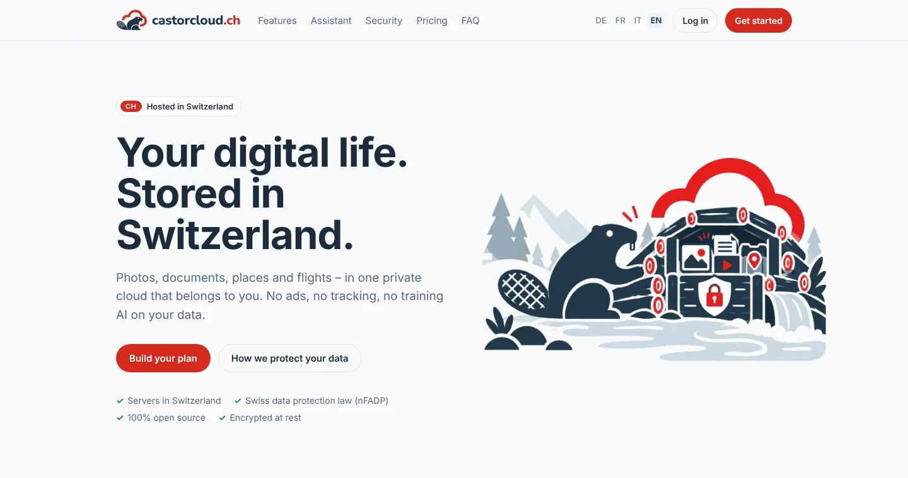
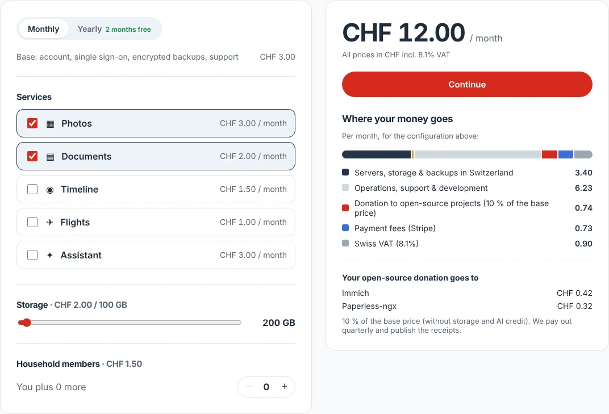
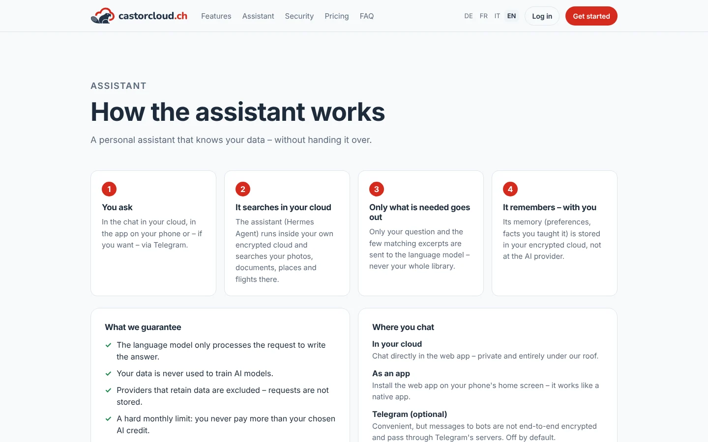
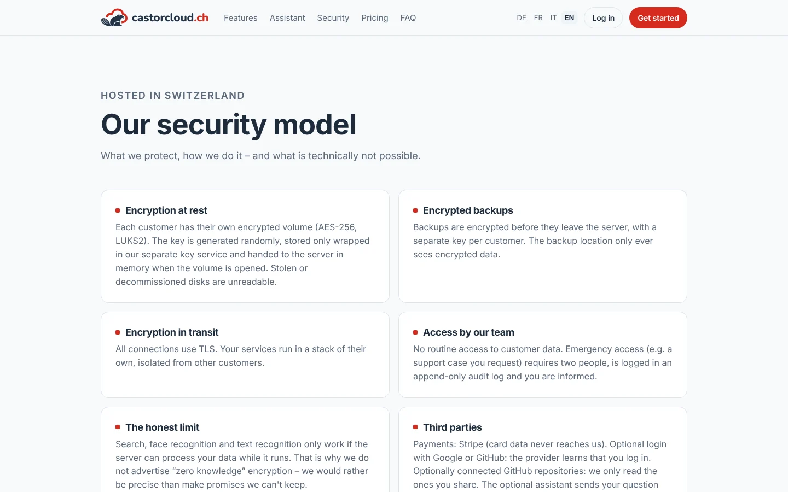
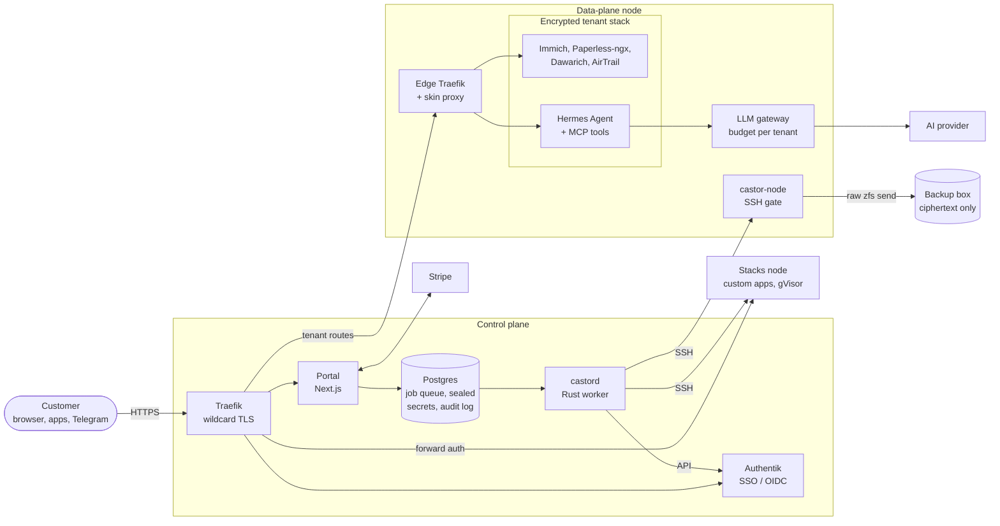
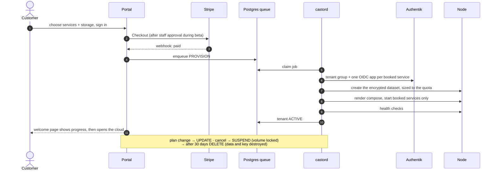

<p align="center">
  
</p>

<p align="center">
  <strong>Your digital life. Stored in Switzerland.</strong><br>
  A Swiss-hosted, privacy-first alternative to Google Photos, Drive scans,
  Maps Timeline and flight trackers.
</p>

<p align="center">
  
  
  
  
  
</p>

Castor Cloud bundles proven open-source apps (Immich, Paperless-ngx, Dawarich,
AirTrail and a Hermes-based assistant) into **one product with one login**.
Every customer gets a **dedicated, encrypted stack**; the portal embeds all
services, themed and signed in, so it feels like a single app.

## Preview

| Home | Pricing calculator |
|---|---|
|  |  |
| **Assistant** | **Security model** |
|  |  |

<sub>Screenshots of the public site from a local development build (beta banner hidden).</sub>

## What a customer gets

| Service | Built on | Replaces |
|---|---|---|
| **Photos** | [Immich](https://immich.app) | Google Photos, iCloud Photos |
| **Documents** | [Paperless-ngx](https://docs.paperless-ngx.com) | scanned docs in Drive |
| **Timeline** | [Dawarich](https://dawarich.app) | Google Maps Timeline |
| **Flights** | [AirTrail](https://github.com/johanohly/AirTrail) | flight-tracking apps |
| **Assistant** | [Hermes Agent](https://github.com/NousResearch/hermes-agent) + our read-only MCP tools | assistants trained on your data |
| **Custom stacks** | reviewed catalog or own Docker images | self-hosting on your own server |

Services and storage are booked individually. The pricing page shows where
every franc goes: VAT, Stripe fees, infrastructure, operations and a
**10 % donation to the open-source projects** the customer uses.

## Architecture



**How it fits together**

- **One registrable domain.** The portal, Authentik and every service share it,
  so embedded services are same-site and one wildcard certificate covers all
  tenants. Service hosts are flat (`photos-<slug>.<domain>`).
- **Portal shell + skin.** Each service runs in a full-height iframe. A skin
  proxy injects brand CSS and a `postMessage` bridge, hides upstream chrome and
  restricts `frame-ancestors` to the tenant's portal.
- **Jobs, not requests.** The portal only enqueues jobs in Postgres; the Rust
  worker `castord` executes them (provision, update, suspend, resume, restore,
  revoke access, delete) and runs recurring tasks (backups, usage, retention).
- **No cluster.** A tenant is placed on one node at provisioning and its data
  stays there. Nodes are plain Docker hosts driven over a restricted SSH gate.
- **Untrusted code elsewhere.** Customers' own apps run on separate stacks nodes
  with user-namespace remapping, gVisor and an egress allowlist, never next to
  tenant data.

### Lifecycle of a cloud



## Security at a glance

Security is the first priority; details and honest limits are in
[docs/security.md](docs/security.md).

- **Encryption at rest:** one encrypted dataset per tenant, its key generated
  randomly and stored only wrapped (envelope encryption) in the control plane.
  Deleting the key crypto-shreds every copy, backups included.
- **Encrypted backups:** raw ZFS streams; the backup box never holds a key.
- **Isolation:** a dedicated stack per tenant, per-service OIDC apps bound to the
  tenant's group, read-only assistant tools scoped to the asking member.
- **Assistant privacy:** only the question and a few matching excerpts reach the
  language model, under a hard monthly budget; providers that retain data are
  excluded.
- **Staff access:** no routine access; emergency access needs two people and
  lands in an append-only audit log.
- **Supply chain:** actions pinned by SHA, scanner images by digest, signed
  images, CodeQL, gitleaks, Trivy, hadolint and `cargo audit` on every PR
  ([docs/ci.md](docs/ci.md)).

## Documentation

| Topic | Document |
|---|---|
| Architecture and roadmap | [docs/architecture.md](docs/architecture.md) |
| Security model (what we protect, and what we can't) | [docs/security.md](docs/security.md) |
| Assistant (Hermes, memory, LLM, credit limit) | [docs/assistant.md](docs/assistant.md) |
| Custom stacks (customers' own apps) | [docs/stacks.md](docs/stacks.md) |
| Backups and restore | [docs/backups.md](docs/backups.md) |
| Monitoring and alerts | [docs/monitoring.md](docs/monitoring.md) |
| CI, security gates and images | [docs/ci.md](docs/ci.md) |
| Beta applications and newsletter | [docs/beta.md](docs/beta.md) |
| GitHub login and repository access | [docs/github.md](docs/github.md) |
| Moving the core to Rust | [docs/rust-core.md](docs/rust-core.md) · [rust/README.md](rust/README.md) |

## Repository layout

| Path | What |
|---|---|
| `apps/portal` | Next.js: marketing site, signup, account, tenant shell, admin console, Stripe webhook |
| `packages/pricing` | Price list (CHF) and the transparent breakdown, shared by site and checkout |
| `packages/core` | Envelope encryption (secrets, volume keys), job queue, audit log |
| `packages/db` | Prisma schema and migrations of the control plane |
| `packages/stacks` | Parser, validator and renderer for custom stacks |
| `packages/brand` | Brand tokens, skin CSS injected into services, iframe bridge |
| `packages/stack-templates` | Per-tenant compose (one profile per service), skin proxy, pinned versions |
| `rust` | `castord` worker, `castor-admin`, `castor-monitor`, `castor-telegram` CLIs, `castor-node` gate on the nodes ([rust/README.md](rust/README.md)) |
| `agent/tools` | Read-only MCP tools of the tenant assistant (Rust, image `pc-assistant-tools`) |
| `infra/control-plane` | Traefik, Postgres, Authentik (+ blueprints) |
| `infra/node` | Shared node services, LLM gateway, egress proxy, `cryptd` volume helper, TrueNAS and macOS setup |
| `infra/backup` | `castor-backup`, the receiving side on the backup box |
| `infra/dev-certs` | Local CA + wildcard certificate for development |

## Local development

Requires Docker Desktop, Node 24 and a Rust toolchain. `*.brand.localhost` resolves to your machine.

```bash
cp .env.example .env                                   # replace every change-me value
npm install
bash infra/dev-certs/generate.sh brand.localhost       # dev CA + *.brand.localhost cert
npm run cp:up                                          # Traefik, Postgres, Authentik
npm run db:migrate
npm run dev -w @pc/portal                              # portal on :3000 (via Traefik)
cargo build --release -p castord --manifest-path rust/Cargo.toml
set -a; . ./.env; set +a; rust/target/release/castord # provisioning worker
```

Trust the dev CA once (current user only), then restart the browser:

```powershell
certutil -user -addstore Root .dev-certs\ca.crt
```

- Site: https://app.brand.localhost
- Authentik admin: https://auth.brand.localhost (`akadmin` / `AUTHENTIK_BOOTSTRAP_PASSWORD`)
- Traefik dashboard: http://localhost:8080

### Tests

```bash
npm run typecheck && npm test                          # TypeScript packages and portal
cd rust && cargo test && cargo clippy --all-targets -- -D warnings
```

### Payments

Without Stripe keys set `DEV_SKIP_PAYMENT=true`: signup provisions directly.
With Stripe test keys:

```bash
npm run stripe:sync -w @pc/portal      # products + prices from packages/pricing
stripe listen --forward-to https://app.brand.localhost/api/stripe/webhook --skip-verify
```

Put the printed `whsec_…` into `STRIPE_WEBHOOK_SECRET`.

### Google login

Create an OAuth client (type *Web*) in Google Cloud Console with redirect URI
`https://auth.<BASE_DOMAIN>/source/oauth/callback/google/`, set
`GOOGLE_CLIENT_ID` / `GOOGLE_CLIENT_SECRET`, then `npm run cp:up`.

### GitHub login and repositories

Login: a GitHub OAuth App with callback
`https://auth.<BASE_DOMAIN>/source/oauth/callback/github/`, into
`GITHUB_LOGIN_CLIENT_ID` / `GITHUB_LOGIN_CLIENT_SECRET`. Repository access: a
separate GitHub App, `GITHUB_APP_*`. Both are described in
[docs/github.md](docs/github.md).

### Provisioning test

```bash
rust/target/release/castor-admin e2e --delete   # provision a test tenant, verify, delete
```

## Notes

- HTTPS is required even in dev: Immich (and others) refuse plain-HTTP OIDC issuers.
- Service hosts are flat (`photos-<slug>.<domain>`) so one wildcard certificate
  covers every tenant.
- Traefik must be ≥ v3.6 with Docker Engine 29.
- Authentik config lives in `infra/control-plane/authentik/blueprints`; the
  enrollment flow is instantiated by the worker at startup.

## Open source

Castor Cloud stands on Immich and Dawarich (AGPL-3.0), Paperless-ngx and
AirTrail (GPL-3.0) and Hermes Agent. Their names and licenses belong to their
projects, and 10 % of every base price goes back to the projects a customer
uses.
